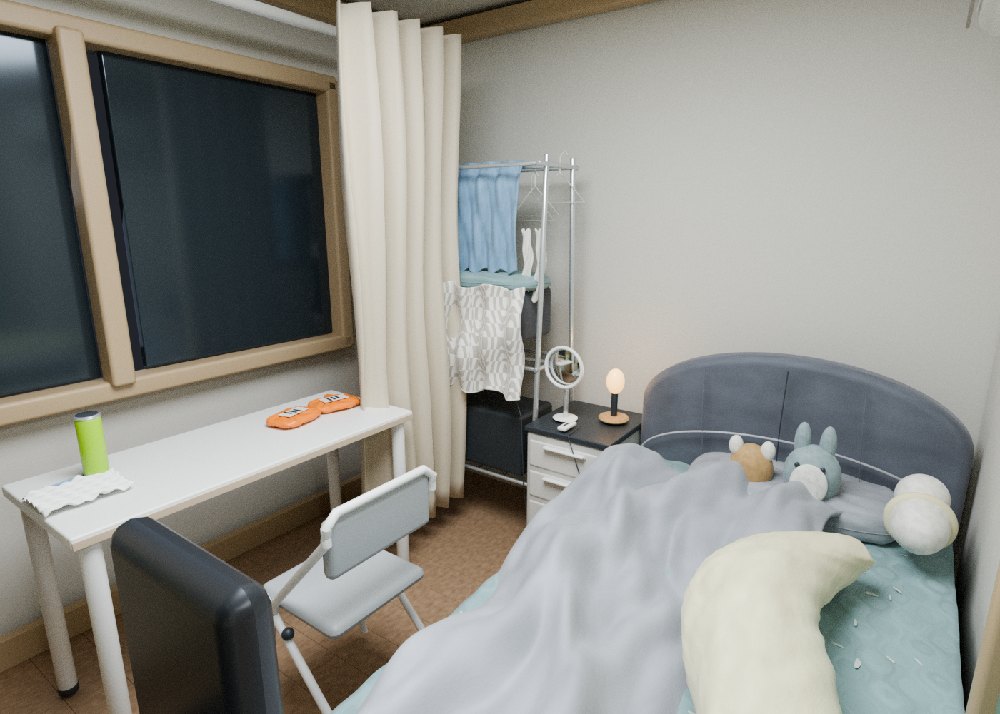
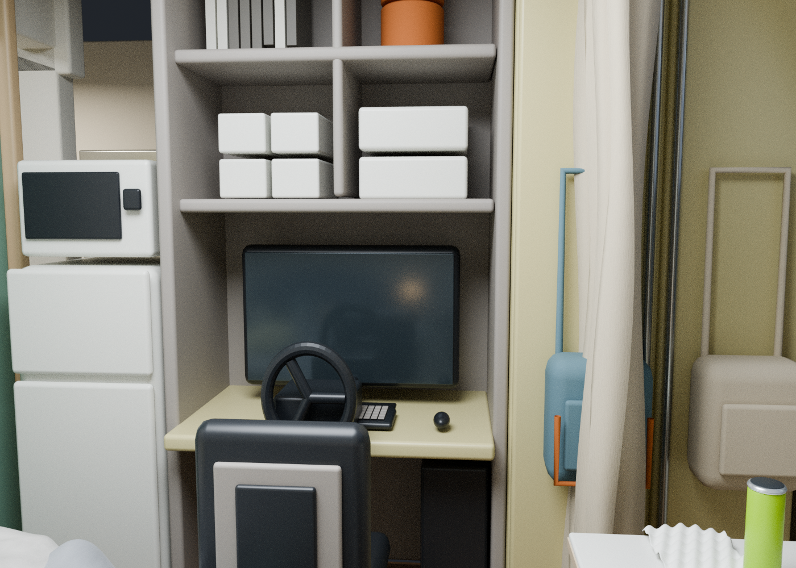
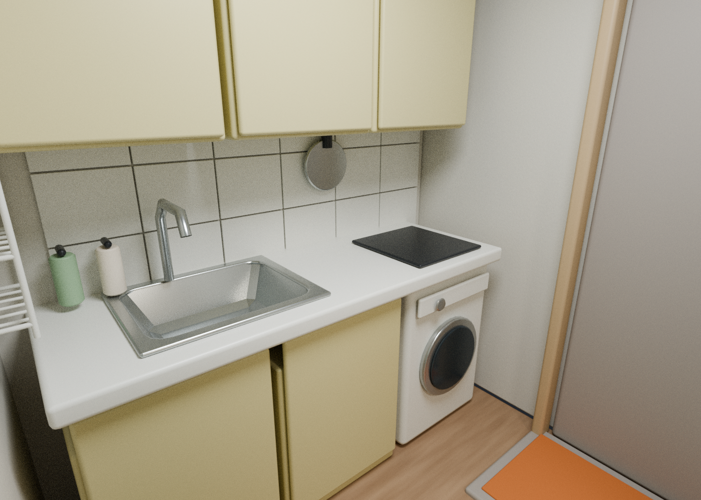
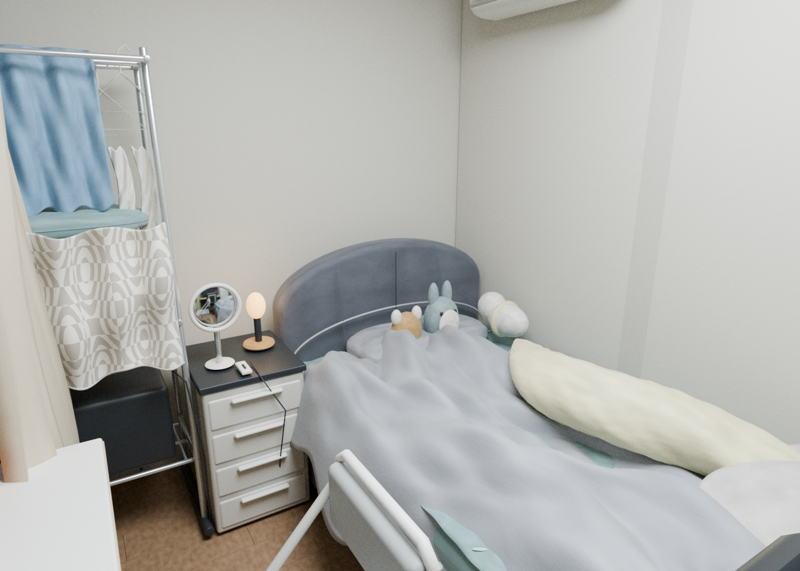

# Home Reconstruction · Blender + Unreal Import Scaffold

An estimated 3D interpretation of a home walkthrough, shared publicly with the owner's approval. The editable Blender scene and four Blender renders are included. This is not a measured survey or a finished Unreal application.

## Blender render gallery

These are the included Blender renders, not Unreal Engine screenshots.

## Included files

- `Home_Reconstruction.blend`: authoritative Blender 4.3.2 scene, 615 objects and 51 materials
- `01_Render.png`, `02_Workstation.png`, `03_Kitchen.png`, `04_Final.png`: four 1400×1000 Cycles CPU renders, 256 samples
- `Home_Reconstruction.fbx` and `Home_Reconstruction.glb`: exchange geometry and simplified materials
- `build_home.py` and `furnishings.py`: procedural generation scripts
- `finalize_exports.py`: regenerate exchange files from the saved Blender scene
- `Unreal_Import_Kit/`: project descriptor, FBX and an untested Editor Python import script
- `README_검증과_치수.txt`: detailed Korean modeling assumptions, source references and limitations

## Blender usage

Open the `.blend` in Blender 4.3.2 or a compatible version. The four named cameras provide the supplied viewpoints. A CPU renderer is sufficient; rendering can take several minutes per view.

For a procedural rebuild, copy this repository to a separate working directory, then run `blender --background --python build_home.py`. Add `-- --render` to request the script's render pass. The script overwrites generated model/export files in its directory. The delivered `.blend` is the final reference: generation scripts may not reproduce every later manual/scripted refinement or the exact final render filenames.

To export the authoritative saved scene, run `blender --background --python finalize_exports.py` in a working copy. This overwrites the root FBX and GLB. The Unreal scaffold's duplicate FBX is not automatically updated; copy the new root FBX to `Unreal_Import_Kit/SourceAssets/` when appropriate.

## Unreal status

**Import scaffold only. Not engine-validated, not playable.** No Unreal `.umap`/`.uasset`, character controller, gameplay collision, packaged walkthrough or verified Lumen output is included. Unreal Engine was unavailable in the authoring environment. The descriptor uses 5.4 as a starting point, not a compatibility guarantee.

Read `Unreal_Import_Kit/README.txt` before using its Editor Python script. Inspect dimensions, axes, lights and materials after import. No PBR texture baking was performed: procedural Blender wood/fabric shading may become simple colors, and Blender–Unreal visual parity is not established.

## Estimated dimensions

The model uses a provisional 2.70×3.40 m main room and 2.50 m ceiling. The bed is provisionally 1.10×2.00 m. These values were inferred from relative object sizes, not measured. Hidden geometry, openings, wall thickness and other occluded details are estimates. No visible loft was modeled; this does not establish that the actual home has no unseen loft. Measure before construction, purchases or furniture orders.

## Public-export checks

The raw video, extracted frames, contact sheet, diagnostics and private local paths are excluded. PNG metadata was removed without changing decoded pixels. FBX application-native-file metadata was made relative; model payloads were otherwise preserved. A file-browser path in the Blender UI was made relative; the scene retains 615 objects and 51 materials, no linked libraries, no embedded source images and no text blocks. The original delivered files remain separate.

All individual assets are below 25 MiB. They are stored as ordinary Git binaries; this repository does not contain Git LFS pointers. Binary model revisions do not produce useful line-by-line diffs, so keep procedural source and meaningful commit descriptions alongside them.

No project-wide reuse license is assigned by this export. Blender and Unreal Engine themselves are not included; use their official distributions under their respective terms.
